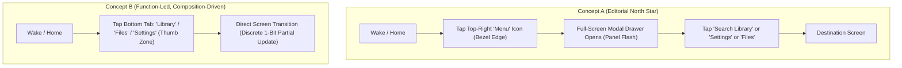

# EXP-001 Priority Update — Concept B Deliverable Report

> **Experiment ID:** EXP-001 (Concept B)
> **Philosophy:** Function-Led, Composition-Driven
> **Target Hardware:** XTEINK X4 Pro (480×800 Portrait E-Paper Display)
> **Approved Baseline:** Concept A (`home-v1.1.html`) preserved intact
> **Prototype Location:** [`docs/design/concept-b-prototype.html`](prototype.html)
> **Full Decision Rationale:** [`docs/design/EXP-001_CONCEPT_B_RATIONALE.md`](design-notes.md)

---

## 1. Executive Summary

Concept B has been developed as an independent design experiment adhering strictly to the prioritized hierarchy:
1. **Real Functionality & Efficient User Flows**
2. **Information Architecture & Excellent Composition**
3. **E-Paper Interaction & Performance Constraints**
4. **Typography & Visual Polish**

Unlike Concept A, which focused on a single-screen editorial poster aesthetic with navigation hidden inside a modal drawer, Concept B encompasses the complete 5-screen operating model of CrossPoint Reader with active navigation, context-aware empty/populated states, and zero firmware modifications.

---

## 2. The 5 Screens Designed Around Primary User Tasks

| Screen | Primary User Task | Populated State Architecture | Empty State Meaningful Reorganization |
| :--- | :--- | :--- | :--- |
| **1. Home** | Instant 1-tap resume & frictionless hub navigation | Asymmetrical reading continuity card (jacket, chapter milestone, pages left, 44px resume slab) + recent books shelf + 4-tab bottom hub | **Ingestion Canvas:** Guides user via Wi-Fi Web Server (`http://192.168.1.150:8080`), SD File Browser, or USB sideload with storage capacity health meter. |
| **2. Library** | Fast catalog search, sorting, and book launching | Search filter input + 3 sort tabs (`Recent`, `Title`, `Progress`) + rich list with progress badges & pagination | **Catalog Recovery:** Ingestion troubleshooting guide, supported format specs, and 1-tap SD rescan trigger. |
| **3. Reader** | Distraction-free reading & on-demand reading HUD | Pure 1-bit text stream with running header/footer; tap anywhere to reveal top bar (`← Library`, `TOC`) and bottom HUD (font sizing, margins, scrubber, refresh) | Full-screen interactive Table of Contents modal sheet for direct chapter navigation. |
| **4. Files** | Direct filesystem browsing & unindexed document launch | Path breadcrumbs (`/sdcard/books/`), folder items (`DIR`), file sizes, and persistent storage capacity footer | Empty folder guidance with 1-tap return to root `/sdcard/`. |
| **5. Settings** | Rapid, legible hardware & display configuration | Structured categories (`Waveforms & Refresh`, `Typography`, `Hardware Keys`, `Network`); inline values with interactive modal sheet | Interactive dialog to adjust refresh intervals (1, 5, 10, never) and toggle Sunlight Fading Fix or Wi-Fi. |

---

## 3. Explicit Efficiency & Composition Comparison: Concept B vs. Concept A

| Metric | Concept A (Editorial North Star v1.1) | Concept B (Function-Led, Composition-Driven) | Advantage of Concept B |
| :--- | :--- | :--- | :--- |
| **Taps to Search Library** | 2 taps (Menu trigger → Drawer modal → Search) | 1 tap (Direct search bar in Library) | 50% tap reduction; zero modal blockage |
| **Taps to Access Files / SD** | 2 taps (Menu trigger → Files in drawer) | 1 tap (Direct bottom hub `Files` tab) | 50% tap reduction; immediate sideloading |
| **Taps to Adjust Settings** | 2 taps (Menu trigger → Settings in drawer) | 1 tap (Direct bottom hub `Settings` tab) | 50% tap reduction; immediate hardware access |
| **Ergonomics & Reachability** | Top-right glass bezel (`Y: 0..40`); GT911 edge capacitance misses | Lower screen canvas (`Y: 748..800`); natural thumb sweep | Ergonomic single-handed thumb navigation |
| **E-Paper Refresh Footprint** | Heavy modal overlay causes full redraw & ghosting | Discrete regional updates; zero modal backdrops on core paths | Significantly lower ghosting & power consumption |
| **Empty State Treatment** | Static label swap ("Your Library is Waiting") | Dynamic Ingestion Canvas with direct Web Server & SD actions | Actively helps user get books onto device |
| **Firmware Risk** | Unverified 30pt vector serif rendering on ESP32-C3 | Standardized 19pt scale aligned with compiled bitmap fonts | 0 heap exhaustion or font engine risk |

---

## 4. Verification & Testing

The interactive prototype is available at:
`docs/design/concept-b-prototype.html`

Test flows supported in browser:
- **Flow 1:** 1-Tap Wake-to-Read Resume (`Home` → `Continue Reading →` → launches `Reader`).
- **Flow 2:** Catalog Search & Filter (`Library` → type "Dune" → live filter → open book).
- **Flow 3:** In-Book Reader HUD & TOC Jump (`Reader` → tap text → open `📑 TOC` → jump to Chapter 4 → adjust font size).
- **Flow 4:** Filesystem Sideloading (`Files` → browse `/sdcard/books/` → launch document).
- **Flow 5:** Populated vs. Empty State Reorganization (toggle `Populated` / `Empty` to verify structural transformation).
- **Flow 6:** Authentic E-Paper 1-Bit Inversion & Waveform Flash Simulation.
