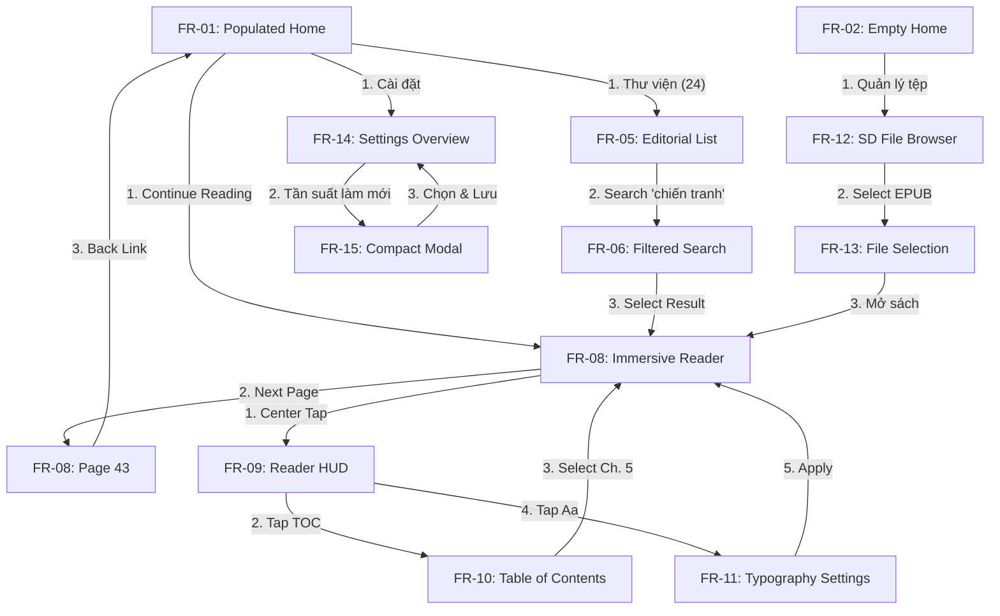

# XTEInk OS — Unified UI/UX Collection Specification (M1)

> **Document ID:** UNIFIED-UI-COLLECTION-SPEC-M1  
> **Status:** Candidate Production Design Specification (M1 Review Gate)  
> **Target Device:** XTEINK X4 Pro (ESP32-S3, 8 MB PSRAM, 480×800 Portrait E-Paper Display, GT911 Capacitive Touch)  
> **Compatibility Baseline:** Generic CrossPoint / ESP32-C3 (380 KB usable SRAM, no PSRAM)  
> **Date:** 2026-11-03  

---

## 1. Visual Grammar & Foundations

### 1.1 Canvas & Coordinate Geometry

| Geometric Parameter | Token Value | Specification & Binding Rule |
| :--- | :--- | :--- |
| **Viewport Dimensions** | `480 × 800 px` | Fixed logical portrait coordinate system. Maps 1:1 to physical panel. |
| **Horizontal Inset** | `32 px` | Uniform left and right content margins across all views (`inset.x = 32px`). |
| **Top Inset** | `20 px` | Preferred top breathing room; system status line rests at Y: 20..44px. |
| **Bottom Clearance** | `24 px` | Minimum clearance between lowest interactive element and screen bottom. |
| **Active Content Width** | `416 px` | Derived: `480px - (2 × 32px) = 416px`. |
| **Alignment System** | Single X-Axis (`X: 32px`) | All headings, labels, buttons, and content rows align to the 32px guide. |

### 1.2 Spacing & Vertical Rhythm

Permitted vertical and horizontal spacing tokens:
`4px` · `8px` · `12px` · `16px` · `24px` · `32px` · `40px` · `56px`

- **Large spacing (40 / 56px):** Semantic zone separation (e.g., between Hero band and Recent shelf).
- **Medium spacing (16 / 24 / 32px):** Component grouping (e.g., between title, author, and CTA).
- **Small spacing (4 / 8 / 12px):** Label-to-value bindings (e.g., between book row title and author metadata).

### 1.3 Typographic Scale & Hierarchy

| Role Token | Size / Line Height | Family & Weight | Primary Usage |
| :--- | :--- | :--- | :--- |
| `type.display` | `34px / 42px` | Editorial Serif, SemiBold (600) | Hero book title (Home), primary empty headline |
| `type.screenTitle` | `30px / 38px` | Editorial Serif, SemiBold (600) | Top-level screen titles (Library, Files, Settings) |
| `type.section` | `17px / 23px` | UI Sans-Serif, SemiBold (600) | Section headers, major utility labels |
| `type.body` | `15px / 22px` | UI Sans-Serif, Regular (400) / SemiBold (600) | Book row titles, body copy, button labels |
| `type.secondary` | `13px / 19px` | UI Sans-Serif, Regular (400) | Author names, chapter subtitles, progress percentages |
| `type.micro` | `12px / 17px` | UI Sans-Serif, Medium (500) | System status indicators, subtle category tags |

#### Vietnamese Typographic Rules (P0 Requirement)
1. **Normalization:** All Vietnamese string literals must be NFC normalized.
2. **Diacritic Clearance:** Minimum line-height multiplier is 1.22 for Serif Display and 1.35 for UI Sans to avoid ascender/descender collision.
3. **Multi-line Title Wrap:** Display titles wrap gracefully up to 3 lines without truncation or text clipping.
4. **No Artificial Tracking:** Avoid negative letter-spacing (`letter-spacing < -0.03em`) on Vietnamese diacritical vowels.

### 1.4 Color Palette & 1-Bit E-Paper Contract

| Color Role | CSS Hex Token | Native 1-Bit Mapping | Contract Requirement |
| :--- | :--- | :--- | :--- |
| `surface.paper` | `#FFFFFF` | White (0) | Pure background surface; zero tinting. |
| `ink.primary` | `#111111` | Black (1) | Text, active icons, solid CTA fills. |
| `ink.secondary` | `#414141` | Black (1) | Metadata text; must remain fully legible when converted to 1-bit. |
| `surface.preview` | `#EBEBEB` | White (0) / Pattern | Preview surface only; must not convey exclusive information. |
| `rule.quiet` | `#BDBDBD` | White (0) or 1px Line | Subtle hairline dividing semantic zones; layout must stand without rules. |

- **Strict Prohibitions:** No glassmorphism, blur effects (`backdrop-filter`), drop shadows, color emojis, or decorative gradients.
- **Single CTA Rule:** Maximum of **one** solid filled black button per screen to establish unambiguous visual dominance.

### 1.5 Touch Target & Ergonomics Contract

- **Minimum Hit Target:** `48 × 48 px` for any interactive element (buttons, row items, links).
- **Primary / Repeated Action:** `≥ 56 px` height (e.g. `Tiếp tục đọc` CTA, navigation return tabs).
- **Target Separation:** Minimum `8 px` clearance between adjacent touch regions.
- **Visual Feedback:** 2px high-contrast focus/active border or color inversion; no subtle opacity dips.

---

## 2. 15 Representative Frames — Detailed State Specifications

### HOME (FR-01 to FR-03)

#### FR-01: Populated Home (Primary Active State)
- **Visual Anchor:** Active book reading hero band (Y: 88..340px).
- **Hero Composition:**
  - Asymmetric two-column split: Left column (270px width) contains Book Title (`Nỗi buồn chiến tranh`), Author (`Bảo Ninh`), reading milestone (`Chương 4 · Trang 42/280`), and progress indicator (`15%`).
  - Right column contains styled Book Jacket (`108 × 154 px`) with title typography.
  - Dominant Primary CTA: `Tiếp tục đọc →` (Height: 56px, black fill, rounded pill or slab, white text).
- **Recent Shelf Band:**
  - Section header: `Đang đọc gần đây` (17/23px Sans SemiBold).
  - Two 1-column book rows (`min-height: 72px`) featuring 40×56px thumbnail, title, author, and completion percentage.
- **Utility Links Band:**
  - Clean editorial links to `Thư viện (24 cuốn) →`, `Quản lý tệp →`, and `Cài đặt hệ thống →`.
  - Zero persistent bottom 4-tab dock.

#### FR-02: Empty Home (First-Use Ingestion Canvas)
- **Visual Anchor:** Typography-driven Ingestion headline (Y: 120..260px).
- **Composition:**
  - Display Headline: `Thư viện trống` (34/42px Serif SemiBold).
  - Contextual Subheading: `Chưa có sách nào trên thiết bị. Kết nối thẻ nhớ hoặc truyền sách qua mạng để bắt đầu đọc.` (15/22px Sans).
  - Primary CTA: `Thêm sách ngay` (Height: 56px, solid black fill, leading arrow).
- **Ingestion Methods Group:**
  - Row 1: `Trình duyệt thẻ nhớ SD` (`/sdcard/books`) — 1-tap scan.
  - Row 2: `Máy chủ Wi-Fi cục bộ` (`http://192.168.1.150:8080`) — Web transfer portal.
  - Row 3: `Kết nối máy tính qua USB` — Hướng dẫn sao chép trực tiếp.
- **System Storage Note:** Discreet footer indicating MicroSD capacity status (`14.2 GB trống / 32 GB`).

#### FR-03: Unstarted / Curated Home (Catalog Present, No Active Session)
- **Visual Anchor:** Featured book curation card / discovery anchor.
- **Composition:**
  - Eyebrow: `GỢI Ý ĐỌC HÔM NAY` (12/17px Micro Sans, tracked).
  - Display Title: `Những người khốn khổ — Tập thứ nhất` (30/38px Serif).
  - Author & Metadata: `Victor Hugo · Bản dịch tiếng Việt kinh điển · 680 trang`.
  - Primary CTA: `Bắt đầu đọc cuốn này →` (Height: 56px).
- **Curated Shelf Section:**
  - 3 unstarted books with badges `Chưa bắt đầu`, complete metadata, and fast-start actions.
- **Direct Navigation:** Jump links to `Toàn bộ thư viện` and `Cài đặt`.

---

### LIBRARY (FR-04 to FR-07)

#### FR-04: Curated Shelf (Editorial Collection View)
- **Visual Anchor:** Featured Collection Header & Hero Book Jacket.
- **Composition:**
  - Header: Top return `← Trang chủ`, Page Title `Kệ sách tuyển chọn` (30/38px Serif).
  - Mode Switcher: Tab bar `[ Kệ sách tuyển chọn (Active) ]` and `[ Danh sách chi tiết ]`.
  - Featured Book Tile: Large 120×170px cover, prominent quote or editorial blurb, author biography link.
  - Secondary Grid: 2-column balanced shelf of curated titles with uniform cover proportions (80×115px).
  - Tap Behavior: Tapping any cover directly opens the Reader at Chapter 1.

#### FR-05: Editorial List (High-Density Catalog)
- **Visual Anchor:** Single-column, information-dense book rows.
- **Composition:**
  - Header: Screen Title `Thư viện sách` (30/38px Serif), count badge `24 cuốn`.
  - Search / Filter Trigger: Tap bar with search icon `Tìm kiếm tựa sách...` and sort toggles (`Gần đây`, `Tên A-Z`, `Tiến độ`).
  - Book Row Structure (Height: 84px):
    - Left: 48×68px book jacket thumbnail.
    - Center: Title (15/22px Sans SemiBold, supports 2-line Vietnamese wrap) + Author (13/19px Sans).
    - Right: Progress badge (`64%`) and reading date (`Hôm qua`).
  - Pagination / Scroll footer: `Hiển thị 1 - 6 trên 24 cuốn`.

#### FR-06: Filtered Search (Interactive Query State)
- **Visual Anchor:** Active search input bar with live filtered results.
- **Composition:**
  - Search Input: Semantic search control with query text (`chiến tranh`), clear button `(×)` (≥48×48px hit target), and return link `← Quay lại danh sách`.
  - Matching Engine: Vietnamese diacritic-insensitive matching (e.g. both `chiến tranh` and `chien tranh` match accurately).
  - Status Line: `Tìm thấy 2 kết quả cho "chiến tranh"`.
  - Result Rows: Filtered book list displaying exact matches with highlighted relevance:
    1. *Nỗi buồn chiến tranh* — Bảo Ninh (Đang đọc · 15%)
    2. *Chiến tranh và Hòa bình* — Lev Tolstoy (Chưa đọc · 1280 trang)
  - Accessible Return: Tapping `(×)` or `← Quay lại` instantly restores the full catalog without losing scroll context.
  - Empty State Handling: Distinct prompt when query is empty vs zero-results notice when no matches exist.

#### FR-07: Empty Library (Zero-State & Diagnostic Recovery)
- **Visual Anchor:** Empty state recovery instructions.
- **Composition:**
  - Screen Title: `Thư viện sách` (30/38px Serif).
  - Illustration / Icon: Stylized 1-bit open book wireframe.
  - Headline: `Chưa tìm thấy sách` (24/32px Serif SemiBold).
  - Clarification Text: Phân biệt rõ giữa *không tìm thấy kết quả tìm kiếm* và *thư viện hoàn toàn trống*.
  - Action 1: `Quét lại thẻ nhớ SD` (Primary 56px CTA).
  - Action 2: `Mở trình quản lý tệp` (Secondary 48px Text Link).
  - Format Support Guide: `Hỗ trợ định dạng: .epub, .txt, .fb2, .pdf`.

---

### READER (FR-08 to FR-11)

#### FR-08: Immersive Reader (Pure Distraction-Free Canvas)
- **Visual Anchor:** Beautifully kerned editorial serif reading text.
- **Composition:**
  - Zero persistent application chrome, navigation bars, or floating buttons.
  - Top Running Header: Subtle chapter title `Chương 4: Tiếng súng xa dần` (12/17px Micro Sans, centered or left-aligned).
  - Main Reading Body: 19px font size, 1.65 line-height, justified or left-aligned, indented paragraphs. Tested with Vietnamese diacritic test text.
  - Bottom Running Footer: Clean reading milestone `Trang 42 / 280 (15%)` · Battery `82%` · Đồng hồ `09:22`.
  - Tap Zones: Left 30% = Page Back; Right 50% = Page Forward; Center 20% = Open HUD (`FR-09`).

#### FR-09: Reader HUD (Contextual Controls Overlay)
- **Visual Anchor:** Top navigation masthead and bottom reading control panel.
- **Composition:**
  - Top HUD Bar: Return link `← Thư viện`, Title `Nỗi buồn chiến tranh`, and quick `Mục lục (TOC)` trigger.
  - Reading Surface: Opaque or high-contrast reading text backdrop.
  - Bottom HUD Panel:
    - Chapter Scrubber: Visual progress bar with current position tag (`Trang 42 / 280 · 15%`).
    - Chapter Stepper: `← Chương trước` và `Chương sau →`.
    - Tool Buttons: `Mục lục (TOC)` · `Cỡ chữ & Kiểu chữ (Aa)` · `Làm mới màn hình (⚡)`.
  - Dismiss: Tapping anywhere in the text area dismisses the HUD and returns to `FR-08`.

#### FR-10: Table of Contents Drawer (TOC Modal)
- **Visual Anchor:** Clean, high-contrast chapter listing modal.
- **Composition:**
  - Modal Header: `Mục lục sách` (24/32px Serif SemiBold), Close button `Đóng (×)` (48×48px).
  - Chapter Items:
    - Row structure: Chapter title, page target (`Trang 1`, `Trang 18`, `Trang 42`, `Trang 88`).
    - Active Indicator: Solid bullet `●` and bold text for currently active chapter (`Chương 4: Tiếng súng xa dần`).
  - Interaction: Tapping any chapter updates reader position and immediately displays the target chapter in `FR-08`.

#### FR-11: Reader Typography Settings (Quick In-Book Tuning)
- **Visual Anchor:** Modal controls for text appearance with live preview.
- **Composition:**
  - Modal Title: `Cài đặt hiển thị đọc` (20/28px Serif SemiBold), Close button `Áp dụng`.
  - Control 1 — Cỡ chữ (Font Scale): Segmented stepper (4 steps: 16, 18, 19px [Chuẩn], 22px). Aligned with approved Reader default 19px.
  - Control 2 — Giãn dòng (Line Height): [ 1.4 (Hẹp) ] · [ 1.65 (Chuẩn) ] · [ 1.8 (Rộng) ]. Aligned with approved Reader default 1.65.
  - Control 3 — Lề trang (Margins): `[ Hẹp (24px) ]` · `[ Vừa (32px) ]` · `[ Rộng (48px) ]`.
  - Control 4 — Kiểu chữ (Typeface): `[ Serif (Có chân) ]` · `[ Sans-Serif (Không chân) ]`.

---

### FILES (FR-12 to FR-13)

#### FR-12: SD File Browser (Root & Folder Hierarchy)
- **Visual Anchor:** File path breadcrumb and structured directory list.
- **Composition:**
  - Header: Return `← Trang chủ`, Screen Title `Trình quản lý tệp` (30/38px Serif).
  - Path Breadcrumb Bar: `/sdcard/books/tieng-viet/` with `[..] Thư mục cha` navigation row.
  - Directory Entries:
    - Folder Rows: Folder icon `[DIR]`, folder name (`Van hoc Viet Nam`), item count (`8 tệp`).
    - Book File Rows: File badge `[EPUB]`, filename (`noi-buon-chien-tranh.epub`), file size (`1.4 MB`), modified date.
  - Footer: MicroSD Card Health & Capacity Bar (`14.2 GB đã dùng / 32.0 GB · FAT32`).

#### FR-13: Direct Sideload / File Selection Modal
- **Visual Anchor:** Selected EPUB file inspection sheet.
- **Composition:**
  - File Information Card:
    - File Name: `noi-buon-chien-tranh.epub` (17/23px Sans SemiBold).
    - Detected Metadata: Tựa sách: *Nỗi buồn chiến tranh* · Tác giả: *Bảo Ninh* · Định dạng: EPUB 3.0 · Dung lượng: 1,420 KB.
    - Validation Status: `Tệp hợp lệ · Sẵn sàng mở`.
  - Action Primary: `Mở sách trong Reader →` (Height: 56px, solid black).
  - Action Secondary: `Quay lại thư mục` (Height: 48px text link).
  - Graceful Error Fallback: If an unsupported file (`.bin`, `.exe`, corrupted zip) is selected, state transitions to clear `Tệp không được hỗ trợ` with explanation and back link.

---

### SETTINGS (FR-14 to FR-15)

#### FR-14: Settings Overview (Editorial Category Index)
- **Visual Anchor:** Grouped, legible 1-bit settings rows.
- **Composition:**
  - Header: Return `← Trang chủ`, Screen Title `Cài đặt hệ thống` (30/38px Serif).
  - Group 1: **Màn hình & E-Paper**
    - `Tần suất làm mới toàn phần`: `Mỗi 10 trang` (Taps open `FR-15`).
    - `Chế độ chống lưu ảnh (Ghosting Fix)`: `Bật`.
  - Group 2: **Đọc sách & Phông chữ**
    - `Phông chữ mặc định`: `Serif (Có chân)`.
    - `Kích thước chữ mặc định`: `16px`.
  - Group 3: **Hệ thống & Kết nối**
    - `Kết nối Wi-Fi`: `Đã kết nối (XTEINK-Office)`.
    - `Máy chủ Web Server`: `Đang tắt`.
  - Group 4: **Thông tin thiết bị**
    - `Thiết bị`: `XTEINK X4 Pro (ESP32-S3 / 8MB PSRAM)`.
    - `Phiên bản phần mềm`: `CrossPoint Reader v2.1.0-x4pro`.

#### FR-15: Compact Settings Modal (Refresh & Waveforms)
- **Visual Anchor:** High-contrast modal dialogue for e-paper refresh settings.
- **Composition:**
  - Modal Surface: Clean white card, 1px black border, 32px padding.
  - Title: `Cài đặt làm mới màn hình` (20/28px Serif SemiBold).
  - Setting 1 — Tần suất Full Refresh: Radio selection list:
    - `○ Mỗi 5 trang` (Chất lượng cao nhất, chớp nhiều hơn)
    - `● Mỗi 10 trang (Khuyên dùng)`
    - `○ Mỗi 20 trang` (Tốc độ nhanh, có thể lưu ảnh nhẹ)
    - `○ Không bao giờ` (Chỉ làm mới thủ công)
  - Setting 2 — Sửa mờ nắng (Sunlight Fading Fix): Toggle `[ BẬT ]`.
  - Action Buttons: `Lưu thay đổi` (Primary 56px) and `Hủy bỏ` (Secondary 48px).

---

## 3. Mandatory Interactive Journeys Specification

- **Journey A (Resume Reading):** `FR-01` → `FR-08` → Page Forward → Return to `FR-01`.
- **Journey B (Find a Book):** `FR-01` → `FR-05` → Tap Search → `FR-06` → Select Book → `FR-08`.
- **Journey C (Reader Controls):** `FR-08` → Center Tap → `FR-09` → Tap TOC → `FR-10` → Select Chapter → `FR-08` → HUD → Tap Aa → `FR-11` → Change Size → `FR-08`.
- **Journey D (Import and Open):** `FR-02` → Tap Quản lý tệp → `FR-12` → Tap `tieng-viet` → Select `noi-buon-chien-tranh.epub` → `FR-13` → Tap Mở sách → `FR-08`.
- **Journey E (Change Settings):** `FR-01` → Tap Cài đặt → `FR-14` → Tap Tần suất làm mới → `FR-15` → Select `Mỗi 5 trang` → Tap Lưu → `FR-14` (displays updated value `Mỗi 5 trang`).
