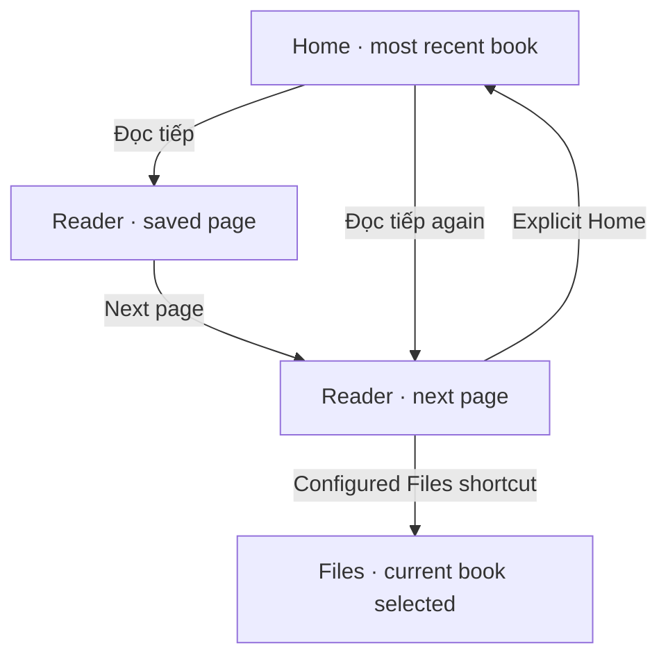
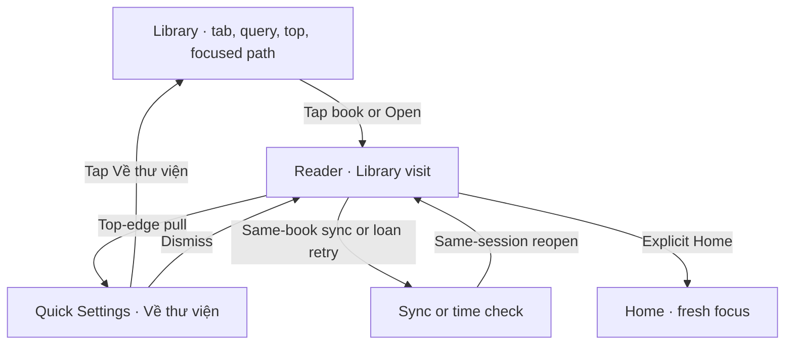
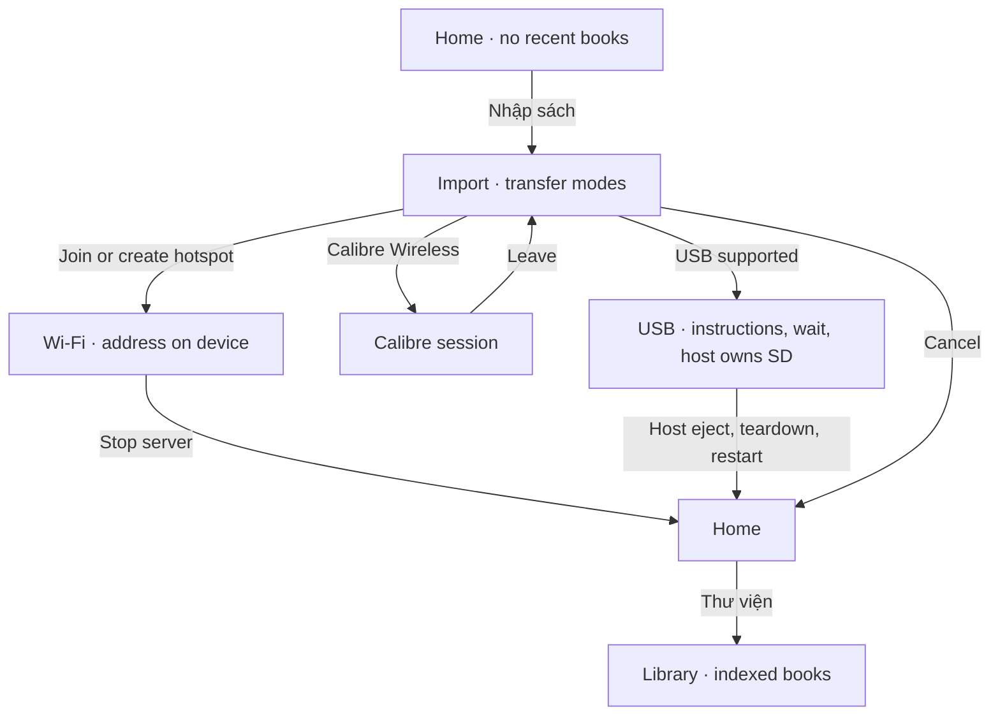
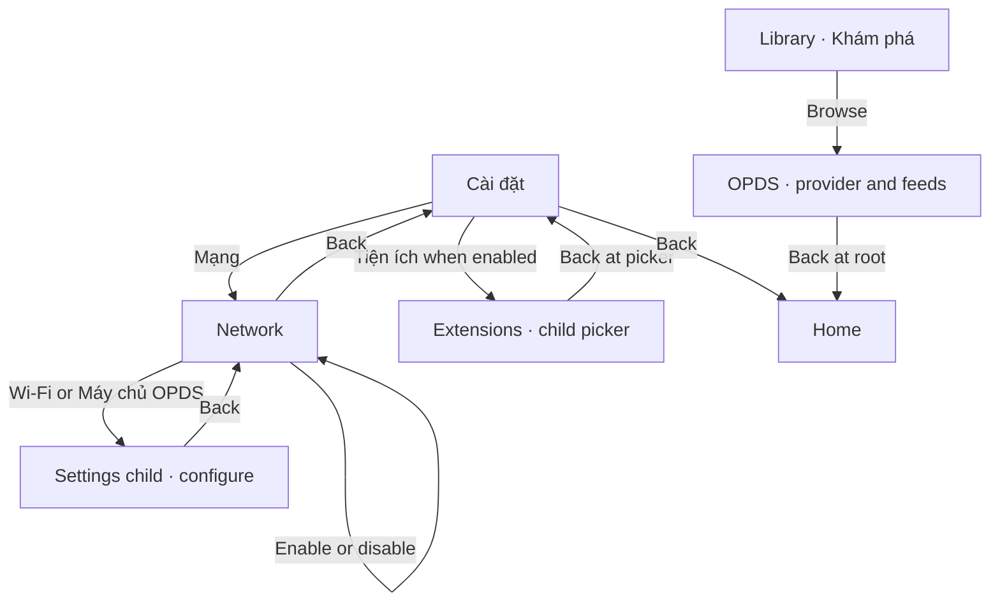

# STEP 06 — UX flows and controls

**Design for PO review · X4 Pro · 480 × 800 logical pixels · 6 November 2026**

**STEP 06 status:** Design complete for review; the PO approved the first-row placement of **Về thư viện** in this handover session. This approves that placement, not the complete visual design or firmware behavior. STEP 07 has not started.

**Recovery evidence, 6 November 2026.** This document already existed as untracked partial work and was preserved. Checkout: `feat/m2-wp2-home` at comparison `19f46d457db84f3d23fc3a57b0de06b1ac48feb8`; baseline object `ad53eb645f27b76c8c4594fafe58479932234bf2` is available locally. SDK gitlink and checked-out HEAD both equal `946e6ac3d7a9d590ba3224428e6183d55ac7917c`. Source checks below use `git show` at the baseline, not comparison behavior. Tracked firmware and SDK diffs were empty at recovery. Existing untracked plans, audits and local skills remain untouched; no Beads workspace was found in the repository or its workspace parent. STEP 01–05 acceptance and Architecture A/NAV-001 follow the current PO handover; older pending-decision wording in the historical audits does not reopen them.

A reader can leave a book in two different places. **Trang chủ** ends the visit. **Về thư viện** returns to the book in the list where the reader found it. The latter is available only for a Library-opened book. The book's saved page and the Library's scroll position have different owners.

**Authority.** [Refoundation plan, steps 06–09](../plans/2026-11-06-xteink-os-refoundation.md) · [STEP 03 feature inventory](../audits/STEP-03-FEATURE-INVENTORY.md) · [STEP 04 route evidence](../audits/STEP-04-ROUTE-TRACE.md) · [STEP 05 navigation and parity contract](../audits/STEP-05-NAVIGATION-CONTRACT.md). Architecture A and NAV-001 are approved. STEP 05 owns the mapping of F01–F44, including formats, tools, settings and recovery outside these four walks.

| Mark | How to read the sheets |
|---|---|
| **S** | Source-inspected behavior at CrossPoint `ad53eb64`. Anchors below refer to that revision. Worktree `19f46d45` is comparison only. SDK pin `946e6ac3`. |
| **U** | Proposed presentation, wording, focus or binding. Reuse the named owner. The new placement or behavior requires implementation. |
| **N** | Approved NAV-001 outcome. Child launch, same-book replacement and reconciliation are future integration work. |
| **H** | Verify on the X4 Pro. A clickable fixture can demonstrate the intended result only. |

## Four flow sheets

Read the arrows as user actions or named system events. The frame column fixes the reading order and touch geometry at native size. Measurements are design values for STEP 07. Coordinates are logical, measured from the portrait top-left. Screen labels below are Vietnamese prototype copy. Shared default: white field, black text, 32 px side insets, usable width 416 px, 48 px minimum action height and at least 44 × 44 px per independent target. Respect actual safe insets and orientation in integration. Focus uses a solid outline or inversion, selection also has a mark or underline. Do not convey state by a pale gray tone alone.

**Typography for STEP 07 (U).** Reuse the project's existing font assets with verified Vietnamese coverage. Start with 28 px screen headings, 24 px book titles/actions and 20 px supporting text, with line boxes of at least 36/32/28 px respectively; increase the box if measured accents need it. Two title lines plus an author require a row of at least 104 px including padding, rather than squeezing into the 64 px minimum. Show fewer rows when necessary. Keep action labels intact; wrap a long label and expand its target instead of shrinking text. These are prototype metrics, not firmware font IDs or a new font dependency. Reader body typography remains controlled by its existing settings.

### A · Home → Resume → Reader → Home

| Frame at 480 × 800 | Control, transition and focus |
|---|---|
| **A1 Home.** Header y=24–80. Title-first current read y=104–328, small cover beside the title, **Đọc tiếp** below. Up to two other books y=352–548. Lower navigation y=564–772 contains Thư viện, Tệp, Nhập sách, Cài đặt in reading order. | **S/U** Tap Đọc tiếp or activate focused recent with mapped Confirm → `HomeActivity::onRecentBookSelected(path)` → `goToReader`. Each other shelf item opens its own path. Normal populated Home entry focuses the first recent. One book has no duplicate shelf row. Two books show one secondary item. Three or more show up to two and keep the full list in Thư viện. |
| **A2 Reading page.** Give the page to the format renderer. Respect existing margins, orientation and status-bar preference. The HUD is transient. | **S** Page gesture or mapped page key turns once. Reader loads and checkpoints its own EPUB/TXT/MD or XTC/XTCH progress. Explicit Home on the page → `goHome` → normal Home focus. Reopening the same path resumes its last valid checkpoint. A Home/Files launch does not offer Về thư viện. |
| **A3 Reader tools.** Reuse the configured EPUB full list or compact toolbar. XTC presents its chapter list only when populated. | **S** Configured menu trigger or Confirm → format tools. Dismiss returns to the same page. Explicit Trang chủ where the existing Reader menu offers Go Home ends the visit. The Files shortcut opens the parent folder with the file selected if available. |

**Fixture.** Use the checked-in `test/epubs/test_br_section_break.epub` as a real source path for the resume scenario. Seed the prototype with two distinct, adjacent valid reading positions. Record them as P and P+1; a successful reopen displays P+1. For layout, use the separate display fixture *Những chuyến tàu đêm qua miền ký ức của người Hà Nội*, author *Nguyễn Thị Ánh Tuyết*. Do not infer real metadata or completion percentage from the test file.

### B · Library → book → contextual Back → Library

| Frame at 480 × 800 | Control, transition and focus |
|---|---|
| **B1 Library.** Header y=24–80 with Back, title and search. Utility row y=88–136 for Khám phá and Làm mới chỉ mục. Three equal tabs y=152–200, book rows y=216–744, 64 px or taller for two lines. | **S/U** Exactly **Gần đây / Tên sách / Tác giả**. Tap a tab to select it, tap the selected tab to reverse order when supported. Tìm kiếm opens the keyboard, submission filters the current tab. Group and row actions keep the Library owners below. Khám phá opens OPDS (D). |
| **B2 Open a row.** Make the whole book row one target. The focus outline encloses its title and author. | **S/N** Tap row, mapped Confirm or hold Recent row → Mở all resolve through `openBookByPath`. Record launched path and top anchor in this Library visit, preserve tab/order/query/group and strip/row focus, close index, clear touch flash, push format Reader as child. Baseline replaces the Library. |
| **B3 Reader → quick panel.** Pull **down from the top edge** on the bare page. Proposed first full-width row, y≈64–120 below panel heading, **← Về thư viện**. Existing controls follow in their current order. No permanent page overlay. | **S** Global gesture pushes `FrontlightPanelActivity` before format input. **U/N** Show the row only when invoked directly over a Library-origin Reader page. Its label names the destination. A tap dismisses the panel with a contextual-exit result; once the Reader owns input again, finish it through NAV-001. Do not synthesize a key press or two generic Backs. Ordinary panel dismiss returns to the same page. |
| **B4 Restored Library.** Same visual row, top anchor and selection as B1. | **N** Reader exits once. The retained Library callback reopens and reconciles the index before painting. Restore exact viewport if order is unchanged. After reorder keep old top where possible and move only enough to show the same path. Explicit Home or Files discards the visit without a Library flash. |

**Touch walk.** The route is identical for EPUB list style, EPUB toolbar style and chapterless XTC. If already in a list, toolbar, chapter picker or modal, first dismiss that layer to the page, then pull down and tap Về thư viện. A panel opened over a child offers ordinary controls only. For an in-place toolbar or popup, eligibility must inspect the active Reader surface as well as the activity type. No dependency on chapters, center-tap, bottom-edge menu gesture, frontlight presence or enabled page-turn touch. While Reader touch is off, keep page touch turns off. A Reader header tap or sideways swipe never means exit.

**Same-book detours.** The manager currently clears all parents on replacement. A later integration must replace only the active child of the retained Library for these *in-session, same-path* transitions. Library keeps the one eventual result callback. Destroy the departing child and release Reader caches/handles before constructing the next heavy reader state. Keep the existing normal replacement behavior for other origins.

| Detour from a Library-opened EPUB | Result to present |
|---|---|
| KOReader sync succeeds, user cancels, Wi-Fi fails or subscriber-only outbox attempt returns | Follow `launchKOReaderSync` and `KOReaderSyncActivity::returnToReader` to the same book. Apply the existing local/remote progress result. Later Về thư viện returns to B4. A pre-sync progress save error leaves the current Reader with its own error. |
| Protected book requests trusted time | Keep the protected-content refusal and existing Wi-Fi child. Success on X4 Pro reopens the same path in-session, then B3 works. Failed clock sync offers **Thử lại** or acknowledgement. Retry repeats the check, cancel/acknowledge or failed child creation finishes to B4. Never open protected content on an unverified clock. |
| Different-book end suggestion, Last Page, explicit Home/Files, actual restart or sleep replacement | Suggestion opens a new origin. Last Page retains this visit. Explicit exits discard the parent. A true restart uses the boot router and stored reading progress; no Library visit survives. |

### C · Empty Home → Import → Wi-Fi or USB → Library

| Frame at 480 × 800 | Control, transition and focus |
|---|---|
| **C1 Empty Home.** At y=104–280 show *Chưa có sách đọc gần đây*, primary **Nhập sách**, secondary **Thư viện**. Reflow the remaining Home actions below; each destination appears once. | **U** First focus Nhập sách. Zero recent books can coexist with files on the card. Import uses `onFileTransferOpen/goToFileTransfer`. Thư viện opens the index even before any book has been read. Tệp opens folders separately. |
| **C2 Nhập sách.** Header and four single-column rows from y=100, ≥64 px each. **Kết nối Wi-Fi**, **Calibre Wireless**, **Tạo điểm phát**, **Ổ USB**. | **S/U** Existing `NetworkModeSelectionActivity` mode values. Enter/re-enter on first available mode. Join → Wi-Fi chooser and password when needed → server. Hotspot → AP → server. Calibre → its client activity → chooser on exit. USB row requires `FREEINK_CAP_USB_MSC`. Chooser cancel → Home, focus Nhập sách on ordinary return. |
| **C3 Wi-Fi transfer.** Mode and connection status above the device-provided address. Visible **Dừng truyền** only on the active server screen. | **S/U** Binding for Dừng truyền uses the same shutdown as server Back. User transfers via the displayed address on another device. Preserve web Files, WebDAV and Calibre endpoints. Cancel Join → mode chooser. Failed authentication stays in Wi-Fi setup for retry or cancel. AP/server startup failure or sustained server disconnect → existing Home exit. Transient reconnect stays in session. |
| **C4 USB.** Before raw handoff show *Chọn Tháo ổ trên máy tính trước khi rút cáp.* Then **Đang chờ máy tính** → **Đã kết nối**. Use static text, no device-side “done” target while mounted. | **S** `UsbDriveActivity` paints the warning before handoff. The host ejects. Device ends handoff and restarts Home. Before connection or after start failure, supported Back/Power/Home input or timeout also restarts. While exclusive, suppress navigation, quick panel, screenshots, index and other device SD I/O. On sustained suspend or I/O error let the owner disconnect/tear down. |
| **C5 After transfer.** Ordinary Wi-Fi exit focuses Nhập sách. USB restart uses normal boot-to-Home focus. | **S/U** Explicitly select **Thư viện** after either return. Let Library reconcile on entry. If an external copy is absent from a still-valid index, **Làm mới chỉ mục** calls the existing rebuild. Show an available supported file, keep focus on the strip on ordinary entry and open only by user action. Never imply a file was imported merely because the session ended. |

### D · Settings → Network, OPDS or Extensions → Back

| Frame at 480 × 800 | Control, transition and focus |
|---|---|
| **D1 Cài đặt.** Header y=24–80, simple section rows from y=96, ≥56 px. Preserve Hệ thống, Hiển thị, Đọc sách, Điều khiển, Thư viện, Mạng. Append **Tiện ích** when enabled. | **S** Section rows → `SettingsListActivity::openSection`. **U** Enabled catalog entry pushes `PluginCatalogActivity` in non-root mode directly from Settings. Its picker Back returns to Cài đặt with Tiện ích focused. Root/Home catalog retains Home exit. |
| **D2 Mạng.** **Wi-Fi**, **Máy chủ OPDS**, **Bật tiện ích** with current Bật/Tắt text; keep eligible sync and network settings. | **S/U** Wi-Fi manages credentials via `WifiSelectionActivity`. Selection/Back returns to Mạng, Wi-Fi row. OPDS manage mode pushes existing editor; editor return rebuilds server rows and starts at row zero; list Back restores Máy chủ OPDS in Mạng. Toggle uses existing Network popup, persist selection and keep focus on Bật tiện ích. Off hides catalog launch but keeps toggle reachable. Back again restores Mạng in Cài đặt; root Back → Home. |
| **D3 Browse from Library.** Khám phá is a utility outside the three tabs. | **U/S** `goToBrowser` with zero servers → picker showing **Thêm máy chủ** → existing editor → picker. One → provider directly. Many → picker → chosen provider. Feed Back unwinds history; root browser Back → Home; picker Back → Home OPDS slot when available. OPDS *management* stays under Mạng, including add/edit/delete, folder, filename and credentials. |
| **D4 Tiện ích.** Disabled → use toggle in Mạng. Enabled with no installed plugins → empty list text and eligible Hub installer row. Installed → manifest-backed rows. | **S/U** Enter catalog item → existing browse/search/auth/README/web-only/Hub flows as applicable. Back unwinds item state, history, picker, then its launch owner. Preserve Hub install/update/hide and uninstall where offered. If the root catalog offers OPDS, that action replaces with the independent OPDS browser. Do not promise a return to Settings from a root replacement. |

## Input and navigation matrix

“Confirm” and “Back” below are **mapped events**. On the X4 Pro the capacitive Home key has configurable tap/double/hold actions. Do not draw dedicated hardware Back or Confirm keys.

| Input and foreground condition | Owner / visible result | After the event |
|---|---|---|
| Tap an actionable row, or mapped Confirm on a focused row | Existing list/chooser activation, with U placements as above. Mapped Previous/Next moves focus through available rows. Touch selects the tapped book before launch. | Apply the destination's entry focus once. Held Confirm/Back release is swallowed across screen changes. |
| Vertical swipe within a Library, Files or Settings list | `UiListActivity` / `UiTabListActivity` and `fui::ListNav` scroll the viewport without changing selected identity or activating a row. A top-edge pull belongs to the global quick panel instead. | A later mapped navigation event moves selection and brings it into view. A fresh row tap selects and opens that row. Preserve selection and viewport as separate fields in the prototype. |
| Tap Library tab / hold book | `LibraryListActivity` selects/reverses sort. Hold Recent → options. Hold unfiltered Title/Author row → groups where supported; open group → member rows. Filtered eligible row → confirmed delete. | Cancel preserves list. Remove from recents and Delete file use distinct confirmations. Keep existing search, rebuild and touch delete handlers. |
| Library header Back or mapped Back | `handleBackAction`: clear query first, else expand groups, else row → tabs when applicable, else Home. | Clearing query resets top. Moving focus to tabs alone preserves viewport. A contextual Reader return must never trigger this chain on the same release. |
| Horizontal swipe, eligible zone tap, mapped side/page key on page | `ReaderUtils::detectTouchPageTurn` and format reader respect RTL, per-direction gesture settings and touch enable. A link tap takes its format action. | Exactly one action. Keep reading position on overlay open/dismiss. No edge Back on the page. |
| Short / long logical Back on bare Reader | Default short → contextual Library if eligible, otherwise Home; long → Files. Reversed mapping swaps these. Duration setting is exposed only on eligible non-touch boards. | Files resolves book path to folder/filename or root. A followed EPUB link takes short Back to its source passage first. Active end-of-book menu consumes short Back to Last Page. |
| Top-edge down swipe, including menu trigger Off + page touch Off | Manager opens Quick Settings before format dispatch. Non-Reader status-band tap remains available on eligible screens outside the Back target. | On eligible bare Reader use B3. Dismiss by supported panel gestures/Back/Home → page. Generic child header Back only dismisses its host. |
| Physical Home action on page / explicit menu Trang chủ | Existing mapped Home or Go Home action → `goHome`. A remapped page/menu gesture performs its configured action. Foreground full menu or quick panel can consume mapped Home to dismiss. | Ordinary Home focus. No Reader callback flashes Library. From a dismissing overlay a separate Home action is required. |
| Back from Files / entry to Import | `FileBrowserActivity`: nested Back → parent; root Back → Home. **U** Files and Settings / System expose Nhập sách using the same transfer owner. Library reaches Files or Import via Home. | FileBrowser's own viewport is independent of NAV-001. A transfer launch follows C even if entered from System. |
| Any input during exclusive USB / screen transition | Exclusive storage loop wins; then on normal frames manager Home/quick panel, foreground modal or format action, eligible Back, then page/list handling. | One physical gesture, one owner. Clear old hit targets and suppress trailing release, including on popup dismiss, child pop, retry or long hold. Do not route a panel tap into the restored row. |

## Exceptional states and fallback order

| Condition | What the reader sees and can do |
|---|---|
| Long Vietnamese title or author; NFC and NFD | Title gets two measured lines on Home and book rows as needed. Ellipsize at a grapheme boundary on the last line. Reserve ascent/descent for stacked accents in *Nguyễn*, *Những*, *Thư viện*. Keep action, focus ring and author distinct. Use the same text in both normalizations. Missing metadata → existing filename fallback. |
| Missing cover / unknown progress / true zero | Omit missing art and reclaim width for title, or retain a plain format mark in a list. Unknown progress omits percentage and bar. A verified zero may read 0%. Home is read-only; no EPUB parsing or XTC chapter loading just to fill an empty field. |
| Stale recent, failed Reader allocation/load or missing book | Prune missing recents. At activation use actual path. Library open failure → usable Library via reconciliation; Home-origin exit → normal Home. Show the actual failure when known. Never open another book automatically. |
| Returned path moved/deleted, filtered out or empty | Reorder → same path and minimum scroll. Missing in unfiltered list → nearest valid row, clamped. A filtered selection lost → preserve query and focus strip, even if other matches remain. Empty → strip and top zero. Keep the nearest surviving top anchor when valid. |
| No matches / index, filter or storage failure | Distinguish *Không tìm thấy sách* (clear query), *Thư viện trống* (Home → Import) and *Không đọc được thư viện* (safe rows only, Back/Home, rebuild when card usable). Invalidate stale ordinals. A failed write, full/read-only/removed SD or FAT interruption cannot promise new progress or a completed copy. Retry after storage is usable; reopen at last valid checkpoint. |
| No mountable SD on boot | Preserve existing SD error gate before normal Home and firmware recovery picker. Reinsert a mountable card and reboot. Empty Home is a normal mounted-card state. |
| Guarded controls | Compile/runtime guards govern USB MSC, BLE HID, RTC, light/warmth, tilt and plugin rows. Omit unsupported actions; standard X4 Pro has no BLE page-turner row, haptics or Picco switch. Network/auth/download failure retains existing retry/back handling. Show no successful download until the owner reports one. |
| Refresh and contrast | Fixed layouts, opaque text, no animation, pulsing status or gradient cues. Limit a focus update to changed rows where supported. Book pages, images and overlay dismissal use existing Reader/display refresh policy. Full/partial waveform, ghosting, speed and image-quality floor need physical evidence. |

## STEP 07 acceptance · smallest clickable prototype

Use fixture data separate from product labels, one portrait viewport at 480 × 800, pointer and keyboard. Map prototype arrows to navigation/page events, Enter to mapped Confirm, Escape to short logical Back and a distinct Home key to explicit Home. Simulate long/reversed Back and capacitive key assignments with fixture controls outside the device. Pointer drag from the top must work; a keyboard shortcut or direct screen picker cannot fulfill the touch walk. Mock host/network/reboot events outside the frame. Every product control drawn in the four journeys must respond or be conditionally absent. Adjacent F-ID branches may use their existing screen contract; avoid decorative dead controls.

| Walk | Pass when a reviewer can observe this result |
|---|---|
| **A · resume** | Start in each Home cardinality 0/1/2/3+. From a populated Home open P, turn once, go Home, reopen at P+1. Check long text, missing art, unknown vs zero progress and ordinary Home focus. Files shortcut selects the book independently. |
| **B · return** | Seed a Title list with query *ký ức*, enough matches to scroll, distinguishable paths, selected book two rows below a nonzero top. Record tab, order, query, group state, top path, focused path and focus owner before open. Tap-open, return touch-only; repeat via mapped Confirm and Recent → Mở. Compare all fields. Repeat both EPUB menu styles and chapterless XTC with menu Off, first with swipe turns on, then with page touch off. With swipes enabled LTR/RTL turns one page; with touch off horizontal swipes turn zero. Top pull plus one tap still returns. Explicit Home skips Library. |
| **B · interruptions** | Exercise short Back from a followed link and dismiss full menu, toolbar and quick panel: each affects only its layer. Simulate sync success/cancel/failure, protected-time success/retry/cancel, Reader load failure, reorder, moved/deleted path, lost filter match, empty list and index failure. Compare the expected focus or same-book return above; no double activation on release. |
| **C · import** | From empty Home find Import and successfully reach Library via Join and guarded USB. For Wi-Fi exercise failed join/cancel, hotspot start, server exit and Calibre return. USB warning precedes host ownership. During host ownership Back/Home does nothing; host eject → restart → Home → explicit Library, rebuild if necessary. Disable MSC and repeat discovery: chooser still works over Wi-Fi. |
| **D · settings** | Manage saved Wi-Fi and OPDS, Back to initiating section. From Discover exercise 0/1/many servers and root Home return. Toggle extensions off/on, visit empty/installed catalogs, Back from Settings-launched and root-launched pickers. No fourth tab and no disabled catalog entry that opens a dead screen. |
| **Native-size review** | Verify hit regions and focus at the frame edges, tabs, panel and long two-line rows. Compare NFC/NFD titles at 100% scale; accents, labels and action outlines remain legible. Scroll a list without moving selection, then use a mapped navigation event and confirm selection becomes visible. Provide deterministic entry states so STEP 08 can reproduce each failure and capture Home empty/populated, Reader and Import. |

**Later H gates.** Measure retained Library internal heap/minimum/largest block, PSRAM and SD handles through Reader load, sync, repeated return and explicit exit. Verify physical Home mapping, top-edge recognition, progress persistence, card handoff/eject/remount, network failure and protected time on device. STEP 09 owns PO agreement on scoring the requested 90% image-quality floor against identical content rendered at the highest quality on the same panel.

## PO placement decision

**Placement of Về thư viện · approved, 6 November 2026.** The PO selected “Hàng đầu tiên — dễ tìm (đề xuất)” in this handover session. Place it as the first actionable row in the existing quick panel for a Library-origin reading page. It takes one top pull and one visible tap, regardless of format or menu settings. The approved destination, page gestures and independent Home remain fixed. No new product decision remains open in this document; visual acceptance belongs to the later prototype review.

## Source anchors for the builder

| Concern | Baseline path and lines |
|---|---|
| Home, files, factory and progress | `src/activities/home/HomeActivity.cpp:229–236,308–329,568–580`; `src/activities/home/FileBrowserActivity.cpp:91–135,339–375`; `src/activities/reader/ReaderActivity.cpp:32–47,159–161,181–192`; STEP 05 F05, F20, F44 for format/legacy progress details. |
| Library, stack and restored state | `src/activities/library/LibraryListActivity.cpp:83–124,143–229,239–353,674–690`; `src/activities/library/LibraryListActivity.h:144–191`; `src/activities/ActivityManager.cpp:159–224,247–270,327–346`. |
| List selection versus viewport | `src/activities/UiListActivity.h:13–18,47–57`; `src/activities/UiTabListActivity.h:48–71`. |
| Global gestures, child dismissal and format priority | `src/MappedInputManager.cpp:335–368`; `src/activities/ActivityManager.cpp:105–149`; `src/activities/util/FrontlightPanelActivity.cpp:230–278`; `src/activities/reader/ReaderUtils.h:93–174,250–279`; `EpubReaderActivity.cpp:919–941`, `EpubReaderMenuActivity.cpp:95–106` and `XtcReaderActivity.cpp:35–59` under `src/activities/reader/`. |
| Same-path replacements | `src/activities/reader/EpubReaderActivity.cpp:1314–1369,1526–1554`; `src/activities/reader/KOReaderSyncActivity.cpp:84–104`. |
| Import and device storage | `src/activities/network/NetworkModeSelectionActivity.cpp:13–56,85–90`; `src/activities/network/CrossPointWebServerActivity.cpp:98–135,138–258`; `src/activities/network/UsbDriveActivity.cpp:13–102,186–192`; `src/activities/ActivityManager.cpp:361–376`; `src/main.cpp:616–645,869–883`. |
| Settings and catalogs | `src/activities/settings/SettingsListActivity.cpp:81–103`; `src/activities/settings/SettingsActivity.cpp:309–334,380–393`; `src/activities/settings/OpdsServerListActivity.cpp:110–197`; `src/activities/ActivityManager.cpp:313–325`; `src/activities/browser/OpdsBookBrowserActivity.cpp:466–480`; `src/activities/plugins/PluginCatalogActivity.cpp:1294–1347`. |
